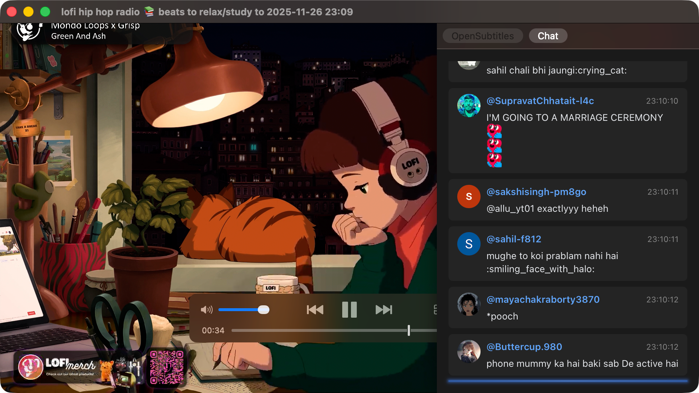

# IINA YouTube Chat

Display YouTube live chat and archived stream chat synchronized with video playback in IINA.




## Features

- **Live Streams**: Fetch and display chat in real-time
- **Archived Streams**: Sync chat with video playback position
- **Rich Display**: Support for Super Chat, memberships, emojis, and more
- **Customizable**: Configure scroll direction, message limit, and display options

## Installation

### Requirements

- [IINA](https://iina.io/) 1.4.0 or later
- [yt-dlp](https://github.com/yt-dlp/yt-dlp) (required for both live and archived stream chat)

### Installing yt-dlp

```bash
# Homebrew (macOS)
brew install yt-dlp
```

### Installing the Plugin

1. Open IINA
1. Go to **Settings** → **Plugins**
1. Select **"Install from GitHub..."**
1. Enter `petamorikei/iina-youtube-chat` and click **Install**

IINA installs the package attached to the [latest release](https://github.com/petamorikei/iina-youtube-chat/releases/latest)
and checks for updates later. You can also download `iina-youtube-chat-<version>.iinaplgz` from the release page and
open it.

### Upgrading from 0.7.x or earlier

Version 0.8.0 changed the plugin's identifier (to `io.github.petamorikei.iina-youtube-chat`) and its name (to
**YouTube Chat**), so IINA cannot update older installations automatically. Remove the old **iina-youtube-chat** plugin
in **Settings** → **Plugins**, then install again as above. Settings return to their defaults.

## Usage

Open a YouTube video in IINA, then display chat using one of the following methods:

### Option 1: Sidebar

1. Click the sidebar toggle button
1. Select the **"Chat"** tab
1. Chat will be automatically loaded and displayed

### Option 2: Standalone Window

1. Go to **Plugin** menu → **YouTube Chat** → **Open Chat Window**
1. A separate chat window will open

The standalone window is useful when you want to keep chat visible while hiding the sidebar, or position it anywhere on your screen.

### Live Streams

- Chat updates in real-time
- Auto-scrolls to new messages when scrolled to the bottom (or top, depending on settings)

### Archived Streams

- Chat syncs with video seeking (fast-forward/rewind)
- Supports playback speed changes

## Settings

Configure via IINA Settings → Plugins → YouTube Chat

| Setting | Description | Default |
|---------|-------------|---------|
| Maximum messages | Max number of messages to display (0 = unlimited; live streams then keep every message in memory) | 200 |
| Scroll direction | Chat scroll direction | Bottom to top |
| Show timestamp | Display message timestamps | ON |
| Show author name | Display author names | ON |
| Show author photo | Display author profile photos | ON |
| Auto-open chat window | Automatically open chat window for YouTube streams | ON |

## Supported Message Types

- Regular text messages
- Super Chat (displayed with colors)
- Super Stickers
- Membership notifications
- Gift memberships
- System messages

## Troubleshooting

### Chat not displaying

- Make sure yt-dlp is installed (required for both live and archived streams)
- **For live streams**: Verify that chat is enabled for the stream
- Regular videos (non-livestreams) do not have chat

### "yt-dlp not found" error

yt-dlp is not installed or not in the system PATH. Install it with:

```bash
brew install yt-dlp
```

---

## For Developers

### Tech Stack

- **React 19** + **TypeScript 5.9**
- **Vite 8** - Build tool
- **Panda CSS** - Styling
- **TanStack Virtual** - Virtual scrolling
- **Zod** - Schema validation
- **Biome** - Formatter/Linter

### Setup

Tool versions (Node.js, pnpm) are managed with [mise](https://mise.jdx.dev/) via `mise.toml`.

```bash
# Install Node.js and pnpm
mise install

# Install dependencies
pnpm install

# Start development server
pnpm dev

# Build
pnpm build

# Code quality check
pnpm check
```

### Project Structure

```
├── Info.json         # Plugin metadata (at root for GitHub distribution)
├── plugin/           # IINA plugin source code
│   ├── entry.ts      # Main entry
│   ├── archivedChatFetcher.ts  # Archived chat fetching
│   ├── liveChatFetcher.ts  # Live chat fetching
│   ├── chatItemParser.ts   # Chat item parsing shared by both fetchers
│   └── youtubeUrl.ts       # YouTube URL handling
├── src/              # React sidebar UI
│   ├── App.tsx
│   ├── components/
│   ├── hooks/
│   └── schemas.ts    # Zod schemas (shared message types)
└── dist/             # Build output (not committed; built by `mise run build` / the release workflow)
```

### Development Plugin Linking

```bash
mise run link     # symlink this folder into IINA as a development plugin
mise run unlink   # remove the link
```

Remove an installed release of the plugin first; IINA refuses two plugins with the same identifier.

### Packaging

```bash
mise run pack     # out/iina-youtube-chat-<version>.iinaplgz (Info.json, dist/, LICENSE, README.md)
```

### Releasing

1. Raise `version` in `package.json` and `Info.json` (same value), and increase `ghVersion` in `Info.json` by one.
   IINA offers an update when `ghVersion` on `main` is higher than the installed one.
2. Commit, push to `main`, then push a tag `v<version>` (for example `v0.9.0`).
3. The [Release workflow](.github/workflows/release.yml) checks the versions, lints, type-checks, builds and publishes
   the release with the `.iinaplgz` attached.

## License

[MIT License](./LICENSE)
